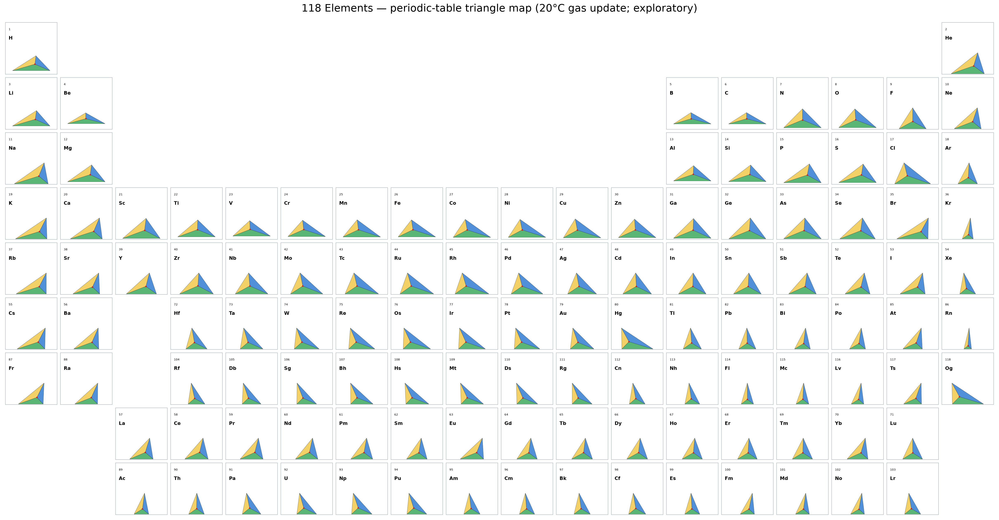
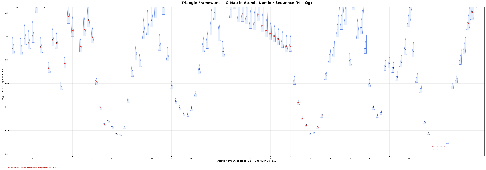
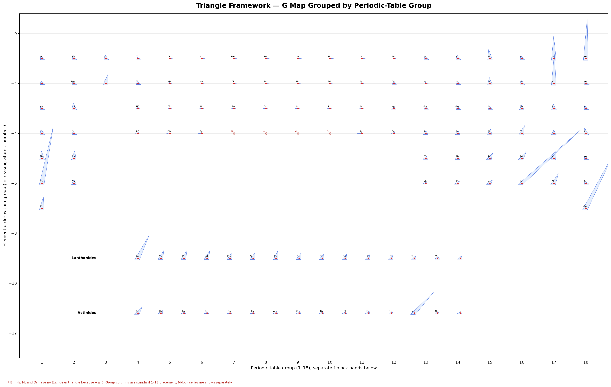

# 118-Element Trait-Match Review — Handover Record
**Date:** 2026-11-22  
**Status:** Exploratory screening completed; physical/chemical trait matching remains open.  
**Scope:** Current `lambda=0.50` phase-rank map and the 118-element dataset. This record does not modify or supersede frozen reference framework 6.2.1.

## 1. Purpose
Assess whether each element's geometric representation appears consistent with the element's known properties, using the user's conceptual meanings for the three sides/sectors. Keep model-derived observations separate from independently measured physical and chemical properties.

## 2. Framework meanings recovered from repository records
- **A — Matter:** particle-dominance / matter-side meaning in the operational 6.0 framework.
- **B — Spacetime:** extension, softness, expansion and related behavior.
- **C — Law:** binding, cohesion, inertia and interaction-related meaning.
- Triangle vertices: A = matter, B = spacetime, C = law.
- In the 6.0 dosage formulation, the largest sector/dosage is used for the dominant attribute. Since dosage is (S=90+\theta/2), it has the same ordering as the angle when all three are valid.
- The conceptual note uses human/family analogies metaphorically. They are not literal physical entities or claims.

Relevant framework references:
- [Original equations and vertex meanings](https://github.com/19REKo91/assistant-cloud-memory/blob/main/PROJECTS/triangle-framework/recovery/original_equations.md)
- [Conceptual note: three sides and relations](https://github.com/19REKo91/assistant-cloud-memory/blob/main/PROJECTS/triangle-framework/conceptual-notes/2026-11-10-three-sides-human-analogy-and-relations.md)
- [Frozen 6.0 foundational constitution](https://github.com/19REKo91/assistant-cloud-memory/blob/main/PROJECTS/triangle-framework/6.0/FOUNDATIONAL_CONSTITUTION_6.0_COMPLETE_USER_PROVIDED_2026-11-19.md)

## 3. Data and files used
### Main input
- [118-element phase-rank CSV — recalculated exploratory lambda=0.50](https://github.com/19REKo91/assistant-cloud-memory/blob/main/PROJECTS/cosmic-triangle-rebalance-118/ELEMENTS_118_PHASE_RANK_20C_RECALCULATED_EXPLORATORY_2026-11-22.csv)
- [20°C recalculation audit](https://github.com/19REKo91/assistant-cloud-memory/blob/main/PROJECTS/cosmic-triangle-rebalance-118/PHASE_RANK_20C_RECALCULATION_AUDIT_2026-11-22.md)

### New derived screening table
- [118-element dominant-sector screening CSV](https://github.com/19REKo91/assistant-cloud-memory/blob/main/PROJECTS/cosmic-triangle-rebalance-118/ELEMENTS_118_PHASE_RANK_20C_DOMINANT_SECTOR_SCREEN_2026-11-22.csv)

This screening CSV preserves Z, symbol, name, phase cohort, A/B/C angles, the derived largest-angle sector, a deliberately limited phase-only screening label, and the original input-status field. The dominant-sector field is derived from the three angles; it is not an independently measured property.

## 4. Main visual evidence
### Current lambda=0.50 periodic-table triangle map

- [Open PNG map](https://github.com/19REKo91/assistant-cloud-memory/blob/main/PROJECTS/cosmic-triangle-rebalance-118/ELEMENTS_118_PERIODIC_TABLE_TRIANGLES_20C_EXPLORATORY_2026-11-22.png)
- [Open SVG map](https://github.com/19REKo91/assistant-cloud-memory/blob/main/PROJECTS/cosmic-triangle-rebalance-118/ELEMENTS_118_PERIODIC_TABLE_TRIANGLES_20C_EXPLORATORY_2026-11-22.svg)

### Earlier B/C 60-cycle maps — separate method, not the lambda=0.50 map
Atomic-sequence map:

Group map:

These two images are visual outputs from the distinct B/C 60-cycle experiment. They must not be interpreted as if they were generated by the lambda=0.50 phase-rank method.

## 5. Verified 118-element screening results
Largest angle (equivalently largest (90+\theta/2) dosage) gives the following dominant-sector counts:

| Phase cohort | A — Matter | B — Spacetime | C — Law | Total |
|---|---:|---:|---:|---:|
| Gas | 2 | 5 | 5 | 12 |
| Liquid | 1 | 1 | 0 | 2 |
| Solid | 35 | 38 | 31 | 104 |
| **Total** | **38** | **44** | **36** | **118** |

### Preliminary observations
1. The solid cohort is distributed across all three sectors: A=35, B=38, C=31. Therefore, phase=solid alone does not determine the dominant sector.
2. In the map's 12 gas-labelled records, only H and Og have A as the largest sector; five are B-dominant and five C-dominant.
3. Og is a predicted/expected input, not an experimentally established room-temperature gas. It must not be treated as equivalent in evidence quality to the other gas entries.
4. The two liquid entries are Br and Hg: Br is B-dominant; Hg is A-dominant. A cohort of two is far too small to establish a liquid-family pattern.
5. The previous visual observation that Ag appears to bridge Pd and Cd is supported geometrically by the angle progression:
   - Pd: A=70.4°, B=40.9°, C=68.7°
   - Ag: A=67.4°, B=46.2°, C=66.4°
   - Cd: A=58.8°, B=52.8°, C=68.4°
   This is a within-map geometric transition (A decreases, B increases, C remains close); it does not establish a chemical mechanism.
6. Other visual observations raised for later testing include near-isosceles/equilateral shapes, similarities among families, and the user's noted zig-zag pattern in centre heights along atomic sequence. These remain hypotheses/pattern observations, not established periodic laws.

## 6. Data-quality limitations
The source audit records the following input-status distribution:
- 83 primary-listed inputs with measurement conditions unspecified.
- 15 predicted/expected inputs.
- 7 secondary-source inputs.
- 7 gas ideal-scaled to 20°C with direct cross-check.
- 4 gas ideal-scaled to 20°C without direct cross-check.
- 2 low-n liquid-cohort inputs.

Consequences:
- The “20°C” label harmonizes the gas calculation basis; it does **not** prove all solid and liquid inputs were measured at 20°C.
- 15 predicted/expected records and 7 secondary-source records require explicit caution.
- Gas scaling uses an ideal-gas correction and does not incorporate real-gas compressibility factors.
- The map's gas cohort contains 12 labels because Og is included as predicted/expected; the 11-element room-temperature gas reference list is a separate data artifact.
- A complete property-match verdict cannot be inferred from phase alone.

## 7. What has and has not been established
### Established within the current data
- The source CSV contains 118 element records.
- All 118 have generated triangles in this lambda=0.50 map.
- The largest-angle sector counts are A=38, B=44, C=36.
- Phase-by-sector counts are shown above and in the derived screening CSV.
- The images and data files linked here were checked as existing repository assets at the time of this handover.

### Not established
- No complete 118-element independent physical/chemical trait-match audit has yet been completed.
- A generated triangle is not proof that its dominant sector matches the element's real properties.
- Solid/liquid/gas phase is not a sufficient proxy for all three conceptual sides.
- The visual map does not demonstrate that atoms are literally triangular or that the three sides are physical entities inside an atom.
- This work does not validate a universal physical law and does not amend frozen reference 6.2.1.

## 8. Required next work
1. Build an independently sourced property register for all 118 elements, preserving source, conditions, confidence and missing values.
2. Translate the conceptual definitions into operational comparison criteria before scoring. Do not invent definitions for ambiguous traits.
3. For A, investigate suitable particle/matter-related indicators; for B, investigate expansion, density, softness and relevant mechanical/volumetric indicators; for C, investigate bonding/cohesion/inertness/interaction indicators. Do not assume one proxy captures an entire side.
4. Keep measured, calculated, estimated and unavailable values distinct.
5. Compare each element's independent property profile with its model-derived dominant sector and shape; classify as **match / partial / mismatch / unresolved**, with a short reason and evidence-quality flag.
6. Do not score the 104 solids as “unresolved” forever merely because they are solids; retrieve relevant independent properties first.
7. Treat gases and liquids as small diagnostic cohorts, not sufficient validation cohorts.
8. Test the Pd–Ag–Cd bridge and the zig-zag centre-height pattern separately against alternative orderings and suitable control comparisons.
9. Preserve the lambda=0.50 experiment as a separate branch of analysis. Do not overwrite reference 6.2.1 or merge B/C 60-cycle outputs into this map.

## 9. Non-negotiable safeguards
- No invented values; missing data remains NA / unavailable.
- Preserve source/version and measurement conditions.
- Do not silently reconcile conflicting sources.
- Do not present derived calculations as source measurements.
- Keep the B/C 60-cycle experiment distinct from lambda=0.50.
- Do not modify the frozen reference framework without explicit user approval.
- This handover documents progress only; it does not approve a new framework version.

---
**Current conclusion:** A complete geometric/phase screening exists for 118 elements, but a scientifically meaningful element-by-element trait-match verdict remains pending independent property collection and an explicit operational scoring protocol.
